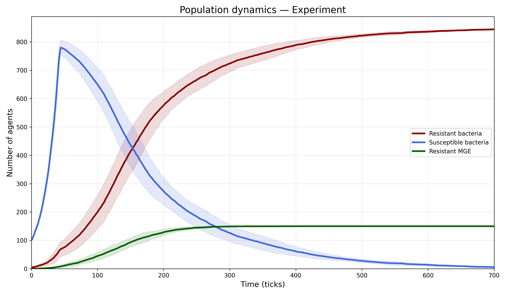

# mecA Antibiotic Resistance Model

## Project Overview

This project uses an agent-based NetLogo model to investigate the spread of mecA-mediated antibiotic resistance in a *Staphylococcus aureus* population.

## Hypothesis

Horizontal gene transfer, mediated by mobile genetic elements (MGE) and transformation, accelerates the spread of antibiotic resistance compared with vertical transmission alone.

## Experimental Design

Two scenarios are compared:

- **Control:** Bacteria reproduce, and mecA is transmitted only from parent cells to offspring (vertical transmission).
- **Experiment:** The same conditions apply, with additional MGE transfer and transformation mechanisms (horizontal gene transfer).

## Objective

To examine how horizontal gene transfer affects the dynamics and spread of antibiotic resistance in a bacterial population.
## Results and Conclusion

The results support the hypothesis that horizontal gene transfer accelerates the spread of antibiotic resistance.

After 700 ticks, the experimental group reached 99.3% resistant bacteria, compared to only 4.1% in the control group. The statistical analysis showed a highly significant difference between the groups (p < 0.001).

These findings demonstrate that MGE-mediated horizontal gene transfer can substantially accelerate the spread of mecA-mediated resistance in a bacterial population.

